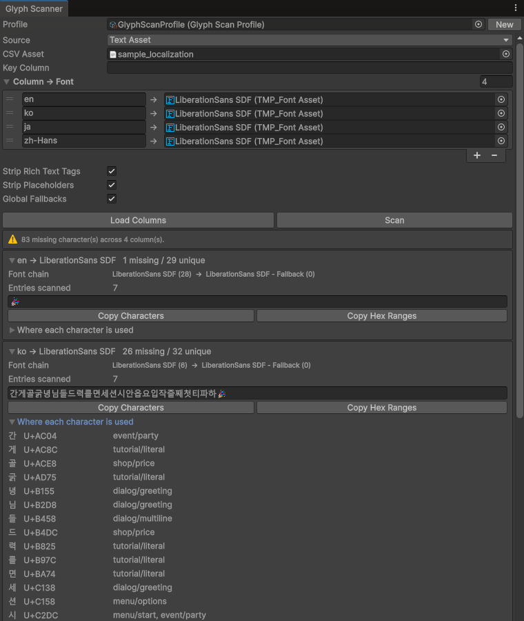
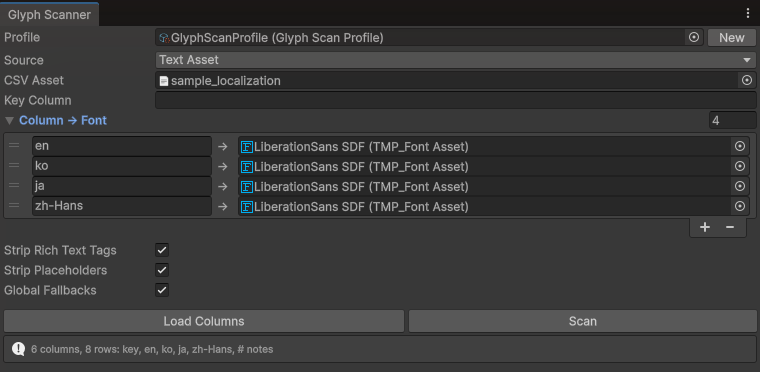

# LocaSync Glyph Scanner

Find the characters your translations use that your TextMeshPro fonts can't render, before players see empty boxes.



LocaSync reads your localization table (a CSV/TSV file, or a Google Sheet without an API key). For each language column it checks every character against the TMP font asset you assign to that language and its whole fallback chain. It then lists only the missing characters, de-duplicated and sorted, ready to paste into the TMP Font Asset Creator.

- Works with any table you can export as CSV: Unity Localization, I2 Localization, or your own sheet.
- Ignores TMP rich text tags and simple placeholders (`{0}`, `{name}`), and applies the tags that change the glyphs: case tags and `<font>`.
- Follows the fallback chain the way TMP does at runtime, including the TMP Settings fallbacks, sprite assets, emoji fallbacks (Unity 6) and the characters Dynamic fonts add from their source font file.
- Shows which keys use each missing character, so you know what to send back to translation.
- Handles emoji and other characters outside the Basic Multilingual Plane.
- Editor-only. Adds nothing to your builds.

## Install

Unity 2022.3+ or Unity 6, with TextMeshPro. Package Manager → **+** → **Add package from git URL…**

```
https://github.com/lsg000/locasync-glyph-scanner.git?path=/com.locasync.glyph-scanner#v0.1.6
```

## Quick start

1. Open **Window → LocaSync → Glyph Scanner** and click **New** to create a profile.
2. Pick your CSV (or paste a Google Sheets link), click **Load Columns**, and use the **+ column** buttons to add one row per language. Assign each row the TMP font asset that renders that language.

   

3. Click **Scan**, then **Copy Characters** (or **Copy Hex Ranges**) and paste into the Font Asset Creator.

To try it without your own data, import **Sample CSV** from the package's **Samples** tab in the Package Manager. The screenshots above use that sample with TMP's default LiberationSans font, which has no CJK glyphs. See the [package README](com.locasync.glyph-scanner/README.md) for all options.

## Repository layout

- `com.locasync.glyph-scanner/`: the package (code, EditMode tests, sample CSV).
- `docs/images/`: README screenshots.
- `My project/`: the Unity sandbox used for development. Only its settings and package manifest are tracked.

## Feedback

This is an early release. Issues and feature requests are welcome: what localization setup you use, which languages, and what the scanner missed.

## License

[MIT](LICENSE)
